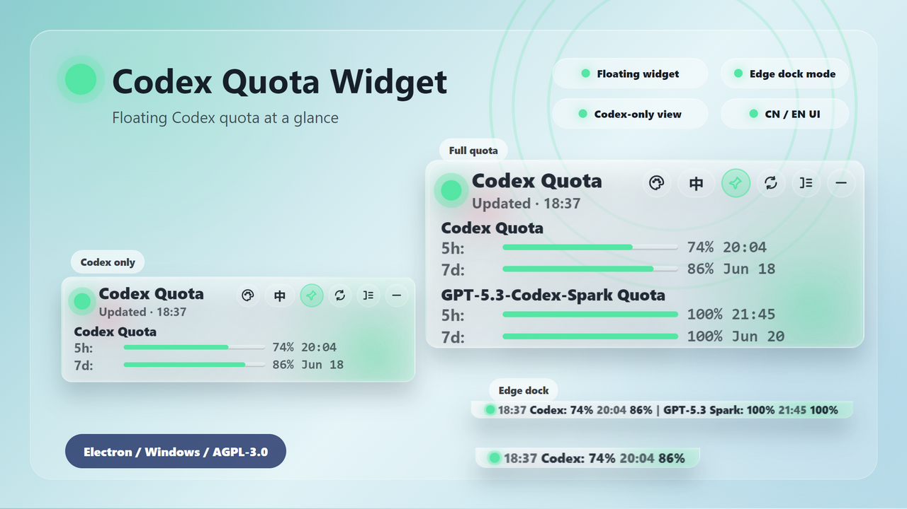

# Codex Quota Widget

<p align="center">
  
</p>

<p align="center">
  <strong>A tiny liquid-glass Windows desktop widget for monitoring your local Codex usage quota.</strong>
</p>

<p align="center">
  <strong>一个用于查看本机 Codex 额度使用情况的 Windows 桌面悬浮小组件。</strong>
</p>

<p align="center">
  <a href="#中文说明">中文</a> ·
  <a href="#english">English</a> ·
  <a href="https://github.com/carrieyummy/codex_quota_widget/releases">Download</a>
</p>

---

# 中文说明

Codex Quota Widget 是一个 Windows 桌面悬浮小组件，用于显示本机 Codex 的剩余额度、重置时间和额度状态。

它采用透明液态玻璃质感界面，通过红、黄、绿三种 LED 状态显示额度健康度，并支持窗口高度调节、系统托盘状态图标、以及背景色 / 字体色 / 透明度自定义。你不用频繁打开命令行或页面，也能快速知道 Codex 额度是否快用完。

---

## ✨ 功能特点

- 🟢 **红绿灯额度状态**
  -  绿色：剩余额度大于等于 30%
  -  黄色：剩余额度小于 30%，但大于等于 10%
  -  红色：剩余额度小于 10%，但大于 0
  -  深红色：剩余额度为 0，或额度读取失败

- 🪟 **液态玻璃悬浮窗口**
  - 透明桌面小组件
  - 无边框、可拖动、默认置顶
  - 默认显示在屏幕右上角，并记住上次窗口位置和高度

- 📌 **顶部贴边收起**
  - 开启贴边收起后，拖动窗口到屏幕上边缘会自动缩略显示
  - 鼠标悬停在缩略条上会自动展开完整窗口，移出后自动恢复贴边缩略状态
  - 左、右、下边缘只会自动夹回屏幕工作区内，不会切换为缩略显示

- ↕️ **可调节信息密度**
  - 支持拖拽窗口上 / 下边缘调整高度
  - 高度增加时显示 Codex 实际返回的主、次额度窗口
  - 高度减少时自动隐藏次要信息，保留关键额度状态

- 🧭 **系统托盘图标**
  - 托盘 LED 图标颜色跟随额度状态变化
  - 鼠标悬停可查看 Codex 实际返回的额度窗口及剩余额度
  - 托盘菜单支持显示 / 隐藏、刷新额度、置顶切换和退出

- 🎨 **自定义外观**
  - 支持自定义背景色
  - 支持自定义字体色
  - 支持调整窗口透明度
  - 设置会保存在本机，下次打开自动恢复

- 🌐 **支持中文 / English 切换**
  - 内置双语界面
  - 主窗口和托盘提示会跟随语言切换

- 🔄 **自动刷新额度**
  - 自动读取 Codex 使用情况
  - 默认每 120 秒刷新一次
  - 也可以从主窗口或托盘菜单手动刷新

- 🔐 **隐私友好**
  - 使用本机已有的 Codex 登录状态
  - 不需要手动输入 Token
  - 不读取、不保存、不上传、不显示认证 Token

---

## 🚀 下载

请前往 **Releases** 页面下载最新版 Windows `.exe` 文件：

👉 [前往 Releases 下载](https://github.com/carrieyummy/codex_quota_widget/releases)

<<<<<<< HEAD
当前版本：`v1.0.7`
=======
当前版本：`v1.0.8`
>>>>>>> 3ece70a82d5207a55e7e826fbe6de4d20d1a2dc3

---

## 🖥️ 运行要求

- Windows 10 / Windows 11
- 电脑上已经安装 Codex
- 本机 Codex 已经登录

---

## 📦 使用方法

1. 打开 [Releases](https://github.com/carrieyummy/codex_quota_widget/releases) 页面。
2. 下载最新版本的 `.exe` 文件。
3. 确保电脑上已经安装并登录 Codex。
4. 双击运行 `.exe`。
5. 如果 Windows 提示未知发布者：
   - 点击 **更多信息**
   - 点击 **仍要运行**

---

## 🔴 额度颜色说明

| 颜色 | 含义 |
|---|---|
|  绿色 | 剩余额度大于等于 30% |
|  黄色 | 剩余额度小于 30%，但大于等于 10% |
|  红色 | 剩余额度小于 10%，但大于 0 |
|  深红色 | 剩余额度为 0，或额度读取失败 |

额度状态仅根据本机可读取到的 Codex 分组计算。窗口只显示实际返回的额度窗口及对应的重置时间，名称以返回的窗口时长为准（例如 5 小时或 7 天）。窗口和贴边条的尺寸以 `src/main/main.js` 中用户维护的 `windowLimits` 为准，并随字体倍率缩放；贴边条根据实际存在的主、次窗口调整宽度。贴边状态下成功刷新额度后会自动调整宽度，读取失败时沿用最后成功数据对应的宽度。

---

## 🧭 托盘说明

Codex Quota Widget 会在 Windows 系统托盘显示一个 LED 图标。

- 单击托盘图标：显示或隐藏小组件
- 右键托盘图标：打开菜单，可刷新额度、切换置顶或退出
- 鼠标悬停托盘图标：查看 5 小时 / 7 天剩余额度
- 切换中英文后，托盘提示也会同步切换语言

---

## 🎨 外观设置

点击窗口右上角的调色盘按钮，可以调整：

- 背景色
- 字体色
- 窗口透明度

修改会立即生效，并保存在本机 `localStorage` 中。下次启动时会自动恢复上次的外观设置。

---

## 🔐 隐私说明

Codex Quota Widget 设计目标是本地化、轻量、隐私友好。

- 使用本机已有的 Codex 登录状态
- 不需要你手动输入 Token
- 不读取你的认证 Token
- 不保存你的认证 Token
- 不上传你的额度数据
- 只显示 Codex 额度相关状态
- 数据保留在你的电脑本地

---

## 🛠️ 本地开发

克隆仓库：

```bash
git clone https://github.com/carrieyummy/codex_quota_widget.git
cd codex_quota_widget
```

安装依赖：

```bash
npm install
```

开发模式运行：

```bash
npm run dev
```

启动应用：

```bash
npm start
```

打包 Windows 便携版：

```bash
npm run build
```

打包完成后，生成文件会出现在 `dist` 文件夹中。

---

## 🔎 API Billing 研究

`research/probe-billing.cjs` 是独立的只读研究工具，用于验证管理员密钥能否查询 API 费用、用量及 Billing 余额；尚未接入小组件，不随当前应用打包。

桌面组件上方的隐私说明针对原有 Codex 读取功能。研究工具会从本机文件读取用户提供的 API 管理员密钥，并仅将其放入发往官方 OpenAI API 的认证请求头；不保存或打印密钥、请求头和原始响应。

PowerShell（先进入仓库根目录，使用支持 `--use-env-proxy` 的 Node.js；本次验证为 v24.14.1）：

```powershell
node --use-env-proxy .\research\probe-billing.cjs
```

脚本没有命令行参数，可调值统一在 `research/billing-probe.config.json` 中维护：

| 配置 | 用途 |
|---|---|
| `keyFile` | 密钥文件路径，相对 `research` 目录；默认 `local_config/admin_key.txt`，即仓库内的 `research/local_config/admin_key.txt`，文件仅包含一条管理员密钥；该目录由根目录 `.gitignore` 忽略 |
| `apiOrigin` | 请求源，仅允许官方 `https://api.openai.com` |
| `lookbackDays` | 向前查询的 UTC 日期数，取值 1～30，并包含今天已发生的时间 |
| `timeoutMs` | 单次请求的超时毫秒数 |
| `maxPages` | 每个费用或用量查询的最大页数，取值 1～10 |
| `outputFile` | 脱敏报告路径，相对 `research`；默认 `output/billing-probe.json` |
| `endpoints` | 查询路径、类别及是否为公开文档接口；未公开地址只用于研究，不作为生产接口契约 |

脚本只执行 GET，禁止自动重定向；`--use-env-proxy` 让请求遵循本机已有的代理环境变量。报告输出到控制台和 `research/output/billing-probe.json`；`research/.gitignore` 已忽略报告目录。报告中的 `complete` 仅表示已读取完整分页，不代表数据实时或费用已经结算。退出码 0 表示探测执行完成，不表示所有接口均可访问；配置/密钥加载失败或全部请求网络失败时返回 1。

2026-11-25 实测结果（查询区间从 2026-10-26 00:00 UTC 至执行时刻）：

| 查询 | HTTP 状态 | 本次结果 |
|---|---|---|
| `/v1/organization/costs` | 200 | 返回 30 个日桶，费用记录为空；不能据此认定消费为零 |
| `/v1/organization/usage/completions` | 200 | 18 次请求；输入 942,306 token，其中缓存输入 816,732；输出 3,436 token。仅为该接口覆盖的用量 |
| `/dashboard/billing/credit_grants` | 403 | 服务端要求浏览器 `session key`，拒绝本次 `secret` 类型密钥 |
| `/v1/dashboard/billing/credit_grants` | 403 | 同上，未取得余额或到期日期 |

结论：提供的管理员密钥有效，可以复用 Electron 主进程与 IPC 架构增加费用/用量查询；本次验证无法直接用它取得 Billing 页的可用余额及到期日期。403 的明确原因是密钥类型要求，不是已确认的权限不足。只有总 token 数而没有周期、实际授予金额和完整计价分类时，不能据此推算页面余额；费用记录为空的原因尚未确认。

若要显示网页中的余额，需要单独验证 Platform 浏览器会话的数据获取方式。Chrome 开发者工具的请求检查因自动化工具无法可靠识别当前 URL 而中止，未核实当前页面实际调用的余额地址；上表两个地址只是独立探测项。当前研究没有导出浏览器登录凭据，也没有接入小组件界面。

官方资料：[Costs API](https://developers.openai.com/api/reference/resources/admin/subresources/organization/subresources/usage/methods/costs)、[Completions Usage API](https://developers.openai.com/api/reference/resources/admin/subresources/organization/subresources/usage/methods/completions)、[用量和额度记录的区别](https://help.openai.com/en/articles/10478918-reviewing-api-usage-and-costs)。

### 按订阅周期估算余额

`research/estimate-cycle-balance.cjs` 按用户确认的额度记录进行对照：2026-11-19 发放 **US$99.00**、2026-12-19 到期，参考可用金额 **US$98.57**。发放金额使用实际记录，不按订阅标称档位推定。该工具复用原研究工具的认证、网络请求和脱敏逻辑，不接入小组件。

PowerShell（仓库根目录）：

```powershell
node --use-env-proxy .\research\estimate-cycle-balance.cjs
```

终端会直接显示预览，并保存 `research/output/cycle-balance.txt` 与 `research/output/cycle-balance.json`，均被 Git 忽略。网页参考金额仅参与最后的差异对比，不参与费用或估算余额计算。

配置位于 `research/cycle-balance.config.json`：

| 配置 | 用途 |
|---|---|
| `connectionConfig` | 原研究连接配置路径；复用密钥路径、官方源、查询地址及超时 |
| `cycle.start` / `cycle.end` | 含时区的 ISO 周期时间；用户目前只确认日期，研究暂按 UTC 零点处理 |
| `cycle.boundariesConfirmed` | 起止时刻是否已确认；设为 `false` 时明确显示假设 |
| `cycle.grantedUsd` | 本期实际授予美元金额，本次为 99；下一周期须按实际发放记录更新 |
| `cycle.otherCreditChangesUsd` | 其他已知额度净增减；本次暂按 0 处理 |
| `cycle.otherCreditChangesConfirmed` | 是否确认没有遗漏的充值、赠送、退款等调整 |
| `webReference` | 用户提供的网页余额及观察时间，非同步参考时保留说明 |
| `groupBy` / `bucketLimit` | 按模型、服务层级、Batch 类型拆分用量；按日分页，每页最多 31 桶 |
| `prices` | 各精确模型、服务层级与 Batch 类型的美元单价、上下文价格档位、官方来源和核验日期 |
| `outputJson` / `outputText` | JSON 明细和终端预览文本的输出路径，相对 `research` |

本次查询到 `gpt-6.2-sol` 与 `gpt-6.1-sol` 的标准非 Batch 文本用量，采用 2026-11-25 核对的[官方价格](https://developers.openai.com/api/docs/pricing)。输入总量包含普通输入、缓存命中和缓存写入，必须拆分计费，不能将写入 token 同时按普通输入再收一遍：

| 分类 | 本期 token 数 | 单价（USD / 百万 token） | 估算费用（USD） |
|---|---:|---:|---:|
| 普通输入 | 54 | 2.00 | 0.0001080 |
| 缓存命中输入 | 816,732 | 0.10 | 0.0816732 |
| 30 分钟缓存写入 | 125,520 | 2.50 | 0.3138000 |
| 12 小时缓存写入 | 0 | 5.00 | 0.0000000 |
| 输出 | 3,436 | 10.00 | 0.0343600 |
| 合计 | | | **0.4299412** |

```text
本期实际发放：US$99.00
文本用量估算消费：US$0.4299412
估算剩余：US$98.5700588
保留两位小数：US$98.57
用户提供的网页参考：US$98.57
```

本次已在显示精度上复现网页参考金额。Costs 查询曾返回空明细，也遇到 `rate_limit_exceeded`（30 次/分钟）；Usage 可独立提供上述分类。脚本不会将空费用当成零消费，也不会把同一区间 Costs 与 token 估算相加扣减。任何查询分页不完整时返回退出码 1，仍会保存有效的观测与明确标注的估算，便于排查。

这仍是文本用量估算：没有管理员可读的发放/调整账本、实际周期时刻、每次请求的上下文价格档位及全部工具/存储等费用，就不能保证后续每次都与网页一致。当前配置采用标准短上下文价格，不自动推定长上下文、地区加价或合同折扣。遇到未知模型、分类缺失、分类合计不一致、图像/音频 token 或分页不完整时，不输出完整余额估算；周期结束后也不继续显示上一周期的剩余值。

核心计算验证位于 `test/verify-cycle-balance.cjs`，覆盖实际用量复现、缓存写入定价、参考值隔离、重复扣费防止、数据缺失和周期过期。PowerShell（仓库根目录）：

```powershell
node .\test\verify-cycle-balance.cjs
```

研究工具仅使用 Node.js 内置模块，不需要新增 npm 或 Python 依赖。

### 分类额度展示与计算研究

`research/collect-quota-overview.cjs` 会生成可双击打开的本地页面，将资金、消费、限额分开展示。PowerShell（仓库根目录）：

```powershell
node --use-env-proxy .\research\collect-quota-overview.cjs
Invoke-Item .\research\output\quota-overview\index.html
```

| 页面分类 | 显示和计算内容 |
|---|---|
| 资金分类 | 本期订阅赠送、购买额度、其他赠送、组织总余额、已知到期批次；各自标注数据来源和未知项 |
| 消费明细 | 模型及缓存分类的美元估算、独立 Costs 观测；图像、音频生成/转写、嵌入、存储、代码解释器、结构化决策、内容审核、文件/网页搜索的原始用量 |
| Codex 与限额 | 本机实际返回的时间窗口、重置时刻、内部 credits；匿名项目的模型速率上限及组织/项目支出上限 |
| 规则与来源 | 订阅赠送、购买、到期、退款/撤销、自动充值、合计、模型计价和产品边界的公式、获取方式与官方链接 |
| 扣减演示 | 编辑假设购买和消费金额，切换赠送到期时刻，观察赠送优先扣减、购买余额独立保留及未覆盖消费 |

当前已知的是本期单笔赠送及文本消费估算。购买额度、其他发放和调整账本没有取得，因此组织总余额保持 **未知**；不能把赠送估算伪装成组织总额，也不能把未取得的数据当成零。单笔赠送估算暂将本周期文本消费归于该笔，不将其他额度调整混入该笔发放。

研究采集只执行官方源 GET 和现有 Codex 的只读查询。项目和模型上限按配置有界读取，项目使用匿名标签；模型列表明确标注分页完整性。若服务端明确返回“未配置组织/项目支出上限”，页面显示未配置；这不等于平台批准的使用上限不存在。只有上限而没有实时已用量时，不计算剩余速率额度。其他用量无返回记录时，也不据此认定免费或零消费。

同一页面的美元资金、token/工具用量、预算和 Codex 百分比分开呈现。消费估算遵循精确模型、服务层级、Batch 和价格配置；同一笔消费不会同时从 Costs 和 Usage 重复扣减。实际完整账本应按时间先后处理发放、充值、消费、到期及调整；演示仅模拟指定时刻的一次未来消费，不重建缺失的历史账本。同类多笔额度按最近到期优先只是演示假设，不作为官方逐笔分摊规则。

`research/quota-overview.config.json` 维护周期配置位置、输出目录、是否读取 Codex/管理限额、项目与速率分页范围、辅助用量路径、演示默认值和资料链接。`research/quota-catalog.json` 维护分类说明。研究页面的尺寸集中在 `research/overview-view.js` 的 `UI_SIZES`；界面验证直接读取它，不在测试或文档复制尺寸。原小组件的尺寸配置未改动。

输出目录中的 `index.html` 内嵌脱敏快照，不含认证信息，也不会连接 API 或自动刷新；`quota-overview.json` 保留选择性研究明细。该目录及测试截图、测试配置均已由 `research/.gitignore` 忽略。浏览页面不需要管理员密钥；刷新数据需重新运行采集脚本。

只修改展示时可从已有快照离线重新生成页面，不读取密钥或重复请求接口。PowerShell（仓库根目录）：

```powershell
node .\research\render-quota-overview.cjs
```

核心计算和数据边界验证位于 `test` 目录；页面另有隐藏 Electron 窗口验证分类切换、窄/宽布局、到期演示和无外部网络请求。PowerShell（仓库根目录）：

```powershell
node .\test\verify-cycle-balance.cjs
node .\test\verify-quota-overview.cjs
```

---

## 📁 项目结构

```txt
codex_quota_widget/
├─ assets/              # README 图片资源
├─ research/            # 额度只读采集、余额估算与分类展示
├─ src/
│  ├─ main/             # Electron 主进程和额度读取逻辑
│  └─ renderer/         # 小组件界面、样式和交互
├─ package.json         # 项目配置和打包脚本
└─ README.md
```

---

## ❓ 常见问题

### 这个工具支持 macOS 或 Linux 吗？

目前主要面向 Windows 使用。如果你需要其他平台支持，可以提交 Issue 或自行适配。

### 我需要手动输入 Codex Token 吗？

不需要。小组件会使用你本机已有的 Codex 登录状态，不需要你手动输入 Token。

### 为什么 Windows 会提示未知发布者？

因为当前应用还没有进行代码签名，所以 Windows 第一次运行时可能会显示安全提醒。如果你确认文件来源可信，可以点击 **更多信息** → **仍要运行**。

### 它会上传我的使用数据吗？

不会。这个工具的目标是读取并显示本机额度状态，不会上传你的额度数据。

### 为什么窗口变矮后少了一些信息？

这是正常行为。窗口高度减少时，小组件会自动隐藏 Codex 的次额度窗口，优先保留主额度窗口；主额度窗口也可能是 7 天额度，以实际返回的数据为准。

---

## 🧩 技术栈

* Electron
* JavaScript
* HTML
* CSS
* electron-builder

---

## 🤝 参与贡献

欢迎提交 Issue 和 Pull Request。

如果你发现 Bug、有功能建议，或者想改进界面，可以直接打开一个 Issue。

支持：1218615410@qq.com

---

## 📄 开源协议

GNU Affero General Public License v3.0 (AGPL-3.0)

---

<br />

# English

Codex Quota Widget is a small Windows desktop widget that shows your local Codex quota, remaining percentage, and reset time.

It uses a transparent liquid-glass interface and a simple red / yellow / green LED status indicator. It also supports adjustable window height, a system tray status icon, and custom background color, text color, and opacity, so you can keep an eye on Codex usage without repeatedly opening a terminal or account page.

---

## ✨ Features

* 🟢 **LED quota indicator**

  *  Green: remaining quota is 30% or higher
  *  Yellow: remaining quota is below 30% and 10% or higher
  *  Red: remaining quota is below 10% and above 0
  *  Dark red: remaining quota is 0, or the quota read failed

* 🪟 **Liquid-glass desktop widget**

  * Transparent floating window
  * Frameless, draggable, and always-on-top by default
  * Opens near the top-right of the screen and remembers its last position and height

* 📌 **Top-edge dock mode**

  * When edge docking is enabled, dragging the widget to the top edge collapses it into a compact strip
  * Hovering the strip expands the full widget automatically, and moving the mouse away restores the docked strip
  * The left, right, and bottom edges only keep the widget inside the screen work area; they do not trigger compact mode

* ↕️ **Adjustable information density**

  * Drag the top or bottom edge to adjust the widget height
  * Expand the window to show the primary and secondary quota windows returned for Codex
  * Shrink the window to hide secondary details and keep the key quota status visible

* 🧭 **System tray icon**

  * Tray LED color follows the current quota state
  * Hover the tray icon to view the quota windows and remaining allowance returned for Codex
  * Tray menu supports show / hide, refresh, always-on-top toggle, and quit

* 🎨 **Custom appearance**

  * Custom background color
  * Custom text color
  * Adjustable opacity
  * Settings are saved locally and restored on the next launch

* 🌐 **Chinese / English interface**

  * Built-in language switch
  * Main window and tray tooltip follow the selected language

* 🔄 **Automatic refresh**

  * Reads Codex usage automatically
  * Refreshes every 120 seconds by default
  * Manual refresh is available from both the widget and the tray menu

* 🔐 **Privacy-friendly**

  * Uses your local Codex sign-in state
  * Does not ask you to enter a token
  * Does not read, save, upload, or display your authentication token

---

## 🚀 Download

Download the latest Windows `.exe` from the **Releases** page:

👉 [Download from Releases](https://github.com/carrieyummy/codex_quota_widget/releases)

Current version: `v1.0.8`

---

## 🖥️ Requirements

* Windows 10 / Windows 11
* Codex installed on your computer
* Codex already signed in locally

---

## 📦 How to Use

1. Go to the [Releases](https://github.com/carrieyummy/codex_quota_widget/releases) page.
2. Download the latest `.exe` file.
3. Make sure Codex is installed and signed in on your computer.
4. Double-click the `.exe` to run the widget.
5. If Windows shows an unknown publisher warning:

   * Click **More info**
   * Click **Run anyway**

---

## 🔴 Quota Status

| LED Color | Meaning |
|---|---|
|  Green | Remaining quota is 30% or higher |
|  Yellow | Remaining quota is below 30% and 10% or higher |
|  Red | Remaining quota is below 10% and above 0 |
|  Dark red | Remaining quota is 0, or the quota read failed |

The remaining quota is calculated only from the Codex limit group available on your local machine. The widget shows only the quota windows returned, with labels based on their duration (such as 5h or 7d) and their reset times. Window and docked-strip sizes follow the user-maintained `windowLimits` in `src/main/main.js` and scale with the font setting. The docked width reflects the quota windows actually returned. Successful quota refreshes resize the docked strip automatically; failed refreshes retain the width for the last successful data.

---

## 🧭 Tray

Codex Quota Widget adds an LED icon to the Windows system tray.

* Click the tray icon to show or hide the widget.
* Right-click the tray icon to refresh quota, toggle always-on-top, or quit.
* Hover the tray icon to view 5h / 7d remaining quota.
* The tray tooltip follows the selected Chinese / English language.

---

## 🎨 Appearance

Click the palette button in the top-right corner to adjust:

* Background color
* Text color
* Window opacity

Changes apply immediately and are saved in local `localStorage`. The widget restores your last appearance settings on the next launch.

---

## 🔐 Privacy

Codex Quota Widget is designed to be local, lightweight, and privacy-friendly.

* It uses your existing local Codex sign-in state.
* It does **not** ask you to enter a token.
* It does **not** read, save, upload, or display your authentication token.
* It only shows quota-related status information.
* Your data stays on your computer.

---

## 🛠️ Development

Clone the repository:

```bash
git clone https://github.com/carrieyummy/codex_quota_widget.git
cd codex_quota_widget
```

Install dependencies:

```bash
npm install
```

Run in development mode:

```bash
npm run dev
```

Start the app:

```bash
npm start
```

Build Windows portable executable:

```bash
npm run build
```

The output file will be generated in the `dist` folder.

---

## 📁 Project Structure

```txt
codex_quota_widget/
├─ assets/              # README image assets
├─ src/
│  ├─ main/             # Electron main process and quota reader
│  └─ renderer/         # Widget UI, styles, and interactions
├─ package.json         # Project config and build scripts
└─ README.md
```

---

## ❓ FAQ

### Does this work on macOS or Linux?

Currently, this project is mainly built for Windows. You can open an issue or adapt it yourself if you need other platforms.

### Do I need to enter my Codex token?

No. The widget uses your existing local Codex sign-in state. You do not need to enter any token.

### Why does Windows show an unknown publisher warning?

The app is not code-signed yet, so Windows may show a warning when opening it for the first time. You can click **More info** → **Run anyway** if you trust the downloaded file.

### Does it upload my usage data?

No. The widget is intended to read and display local quota status only.

### Why does the widget show less information when it is shorter?

This is expected. When the window height is reduced, the widget hides the secondary Codex quota window first and keeps the primary window visible. The primary window may itself be a 7d allowance, depending on the data returned.

---

## 🧩 Tech Stack

* Electron
* JavaScript
* HTML
* CSS
* electron-builder

---

## 🤝 Contributing

Issues and pull requests are welcome.

If you find a bug, have a feature request, or want to improve the UI, feel free to open an issue.

Support: 1218615410@qq.com

---

## 📄 License

GNU Affero General Public License v3.0 (AGPL-3.0)
